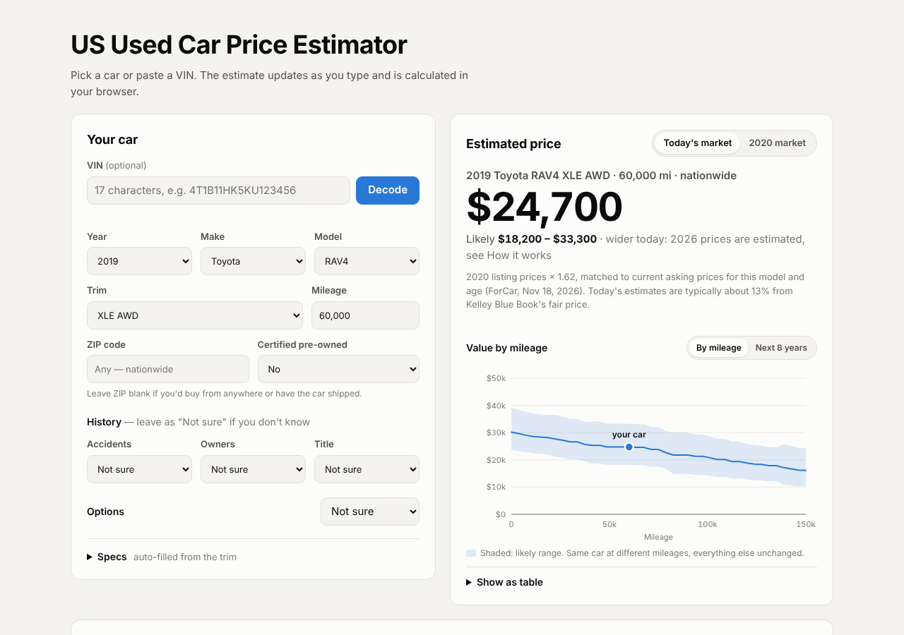

# US Used Car Price Estimator

Estimate what a used car is worth from its year, make, model, trim, mileage, history, options and ZIP code, or just paste a VIN. The model runs entirely in your browser. There's no server to fall asleep, so the site is always up.

**[Try it live →](https://aaronh-uang.github.io/Predict_US_car_price/#year=2021&make=Ford&model=F-150&trim=XLT+SuperCrew+4WD&mileage=60000)**

<p align="center">
  
</p>

## What it does

- **Pick a car or paste a VIN.** Make → model → trim dropdowns fill in the engine, horsepower, drivetrain and mpg from real listings. A VIN is decoded through NHTSA's free API.
- **History, options, location.** Accidents, owners, title, certified pre-owned, 20 common options and ZIP code are all optional. Leave ZIP blank for a nationwide price, if you'd buy anywhere or have the car shipped.
- **A range, not just a number.** Each estimate comes with a likely range that's checked to contain about 8 in 10 real prices.
- **Depreciation charts.** Value across mileage, and projected value over the next 8 years at your pace of driving.
- **Today's market or 2020's.** The model learned from 2020 listings. A per-model adjustment from current asking prices brings it up to date and refreshes every week.
- **Shareable links.** Every estimate has its own URL.

## Results

**On 2020 listings.** Measured on 149,352 cars the model never saw:

| | First version (2025) | Now |
|---|---|---|
| Median error | — | **5.4%** |
| Average error (MAE) | $3,267* | **$1,555** |
| Estimates within 10% | — | **75%** |
| Likely range holds the real price | no range | **80%** |
| Hosting | Streamlit (sleeps when idle) | GitHub Pages (always on) |

<sub>*From the first notebook's own test split. That version's live app sent every car's model and trim as "Unknown", so real-world error was higher.</sub>

The median error is 4.5–6% for cars over $10,000 (best at $20–60k) and 10.5% under $10,000. Cheap cars are old, high-mileage cars, where condition matters most and the data has the least to say.

Filling in the optional fields helps: leaving ZIP blank gives 5.8% median error, leaving options as "Not sure" gives 5.6%, and leaving both gives 6.0%, against 5.4% with everything filled in.

**On today's prices.** Checked weekly against Kelley Blue Book's fair price on current AutoTrader listings:

| | Now |
|---|---|
| Median gap to KBB's fair price | **12.7%** |
| Estimates within 10% of KBB | 41% |
| Typical lean | 4.5% below KBB |

Today's prices are the weaker half, because the model has never seen a 2026 listing. The site says so, and widens the likely range in today's-market mode (×2.4, set by the same check) so it stays honest. The live numbers are in `web/data/benchmark.json`.

## How it works

```
Kaggle CSV (9 GB, 3M CarGurus listings, 2020)
   │  training/prep.py       ~25 columns, used cars only, one row per VIN    → data/listings.parquet
   ▼
training/train.py            LightGBM on log(price), 1.2M training cars
   │                         make/model/trim as native categoricals, options as 0/1 flags,
   │                         location as the 3-digit ZIP area's centre;
   │                         price can only fall as mileage, age, owners or damage rise;
   │                         ZIP/options hidden on 15% of cars so "unknown" has a real answer;
   │                         likely range from a held-out calibration split
   ▼
training/export.py           trees → web/data/model.json (1.8 MB download), trims → catalog/*.json
   ▼
training/calibrate.py        ForCar's current asking prices → web/data/calibration.json   (weekly)
   ▼
training/benchmark.py        KBB check on current AutoTrader listings → web/data/benchmark.json   (weekly)
   ▼
web/                         static site: HTML + 4 small JS files, no build step, no dependencies
```

**Running the model in the browser.** `web/js/model.js` walks the exported LightGBM trees with the same rules LightGBM uses. `tests/parity.mjs` checks that it matches LightGBM's own predictions to within 0.0001%, and that test runs on every deploy.

**Bringing 2020 prices up to date.** For each make, model and model year, [ForCar](https://forcar.org/open-data/) publishes today's average asking price and mileage. The model predicts what that same car would have listed for in 2020, and the ratio becomes an adjustment:

`today = 2020 estimate × exp(age_factor + make_offset + model_offset)`

- Offsets are separate for cars under 8, 8–15 and 16+ years old.
- They are shrunk toward zero for models with few listings.
- They handle naming differences: ForCar's "RX" covers the data's "RX 350" and "RX 450h", and BMW's "328i" maps to "3 Series".
- 99% of ForCar's listings are matched. `artifacts/calibration_rows.csv` shows the working for each one.

**Checking today's prices.** Rebrowser's free AutoTrader sample hides listing prices, but includes KBB's fair-price range. `benchmark.py` prices those cars the way the site does, compares them with the middle of KBB's range, and keeps a growing file of the listings in `benchmark/`.

## Limitations

- **Today's prices are adjusted, not learned.** Expect estimates to land within about 13% of KBB on today's cars, against 5.4% on 2020 cars. Training on 2026 listings would close most of that gap, and that's the next step.
- **Asking prices, not sale prices.** Both the training data and ForCar are dealer listings.
- **Condition is mostly invisible.** The data has accidents, owners and title, but not wear, color or service history.
- **Model years after 2021 have no trims of their own.** They're priced from their model's latest trims, plus age, mileage and the today's-market adjustment.

## Run it yourself

On a Mac with Python 3.11+ (about 12 GB free disk):

```bash
# 1. data: download used_cars_data.csv into ./data/ from
#    https://www.kaggle.com/datasets/ananaymital/us-used-cars-dataset
#    or: pip install kaggle && kaggle datasets download -d ananaymital/us-used-cars-dataset -p data --unzip

# 2. build everything (about 3 minutes on an M3 Pro)
make setup
make all          # prep → train → export → calibrate → benchmark → test
make serve        # http://localhost:8000
```

If `import lightgbm` fails with a `libomp` error, run `brew install libomp`. `make test` needs Node. If you don't have it, the same test runs on GitHub when you push. `make demo` runs the whole pipeline on a small fake dataset, without the 9 GB download.

## Deploy

1. Commit `web/data/`, `artifacts/` and `benchmark/`. Don't commit `data/`, which is git-ignored.
2. In the repo's GitHub settings: **Pages → Source: GitHub Actions**.
3. Push to `main`.

Every Monday, `.github/workflows/deploy.yml` refreshes today's prices from ForCar, reruns the KBB check, commits the results and redeploys. You can also run it any time from the Actions tab.

## Project layout

```
training/    common.py · prep.py · train.py · export.py · calibrate.py · benchmark.py
web/         index.html · styles.css · js/{app,model,chart,vin}.js · data/ (generated)
artifacts/   model.txt · meta.json · parity_fixture.json (generated)
benchmark/   autotrader_kbb.csv.gz: current listings with KBB ranges (grows weekly)
tests/       parity.mjs (browser vs LightGBM) · make_synthetic.py (fake data for `make demo`)
```

## What changed from the first version

The first version was a Streamlit app and is still in this repo's git history. Rebuilding it fixed several things that made its estimates worse than its notebook suggested:

- **Inputs that never reached the model.** Model, trim and engine type were always sent as "Unknown". "Truck" wasn't a category the model knew ("Pickup Truck" was). The torque and owner inputs were ignored.
- **Categories treated as numbers.** They were integer-encoded, so 8,427 trim names were split by alphabetical position. They're now native categoricals.
- **Manual transmissions** were mapped to "automatic".
- **Days on market** was an input, which a buyer doesn't know.
- **Duplicate VINs** could appear in both training and test.
- **2020 prices** were shown as current.

## Data and credits

- **Training:** [US Used Cars dataset](https://www.kaggle.com/datasets/ananaymital/us-used-cars-dataset) (Kaggle), crawled from CarGurus in 2020.
- **Today's prices:** [ForCar open data](https://forcar.org/open-data/), CC BY 4.0.
- **KBB check:** [Rebrowser AutoTrader sample](https://github.com/rebrowser/autotrader-dataset), research and non-commercial use with attribution. Rebrowser is not affiliated with AutoTrader or Kelley Blue Book.
- **VIN decoding:** [NHTSA vPIC](https://vpic.nhtsa.dot.gov/api/).

Estimates are statistical, not an appraisal or an offer.

---
Built by Yonglang (Aaron) Huang · UC Berkeley Data Science · MIT License
